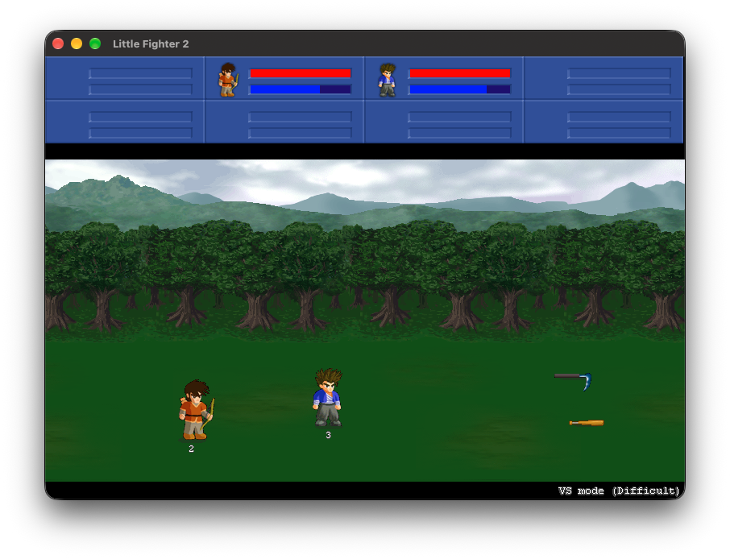

# lf2-macos-port

Turns the Windows game **Little Fighter 2 v2.0a** into a native macOS
application by static recompilation: the machine code in `lf2.exe` is translated
to C and compiled for Apple Silicon, with a small runtime standing in for
Windows. No Wine, no emulator, no source code of the game.

```bash
./install.sh ~/Downloads/LF2_v2.0a.exe
open LF2.app
```

`install.sh` checks the prerequisites and then runs the tool, `lf2port.py`.

The resulting `LF2.app` depends only on macOS system libraries.



*A VS mode fight in the generated app's own macOS window.*

This project contains no game files. You supply your own copy of the original
installer; Little Fighter 2 is freeware by Marti Wong and Starsky Wong and
remains their copyright. The generated app embeds your game files, so do not
redistribute it.

## Requirements

For the tool:

- macOS on Apple Silicon
- Python 3
- Xcode command line tools (`clang`, `objdump`, `codesign`, `afconvert`)
- `ffmpeg` on the `PATH`, used once to decode the game's `.wma` music
  (or pass `--no-music`)

`brew bundle` installs ffmpeg from the included `Brewfile`. The tool uses only
the Python standard library, so there are no Python packages to install.

For the generated app: nothing beyond macOS 11 or later on Apple Silicon.

## Usage

```
./lf2port.py INPUT [-o LF2.app] [--work DIR] [--ffmpeg PATH] [--no-music] [-j N]
```

`INPUT` is the original installer (`LF2_v2.0a.exe`), an installed game folder,
or `lf2.exe` itself. A full build takes about ten seconds.

The tool refuses to overwrite an existing path unless it is an app it built
earlier, and warns if `lf2.exe` is not the v2.0a build it was developed against.

The app keeps everything the game writes (key bindings, recordings, a log) in
`~/Library/Application Support/Little Fighter 2`. To uninstall, delete the app
and that folder. The first launch after a
rebuild can take around ten seconds while macOS verifies the new binary.

Default keys: player 3 uses the arrow keys with Enter (attack), Shift (jump) and
Ctrl (defend); player 2 uses W/X/A/D with S, Tab and `` ` ``; player 1 uses the
numeric keypad. Menus also work with the mouse. Ctrl+Cmd+F toggles full screen.

## How it works

1. **Unpack.** The installer is a Clickteam Install Creator archive; the tool
   parses it directly and never executes it.
2. **Translate.** `recomp/recomp.py` disassembles `lf2.exe` with `objdump`,
   discovers functions by following control flow from the entry point and from
   code pointers found in data, and emits one C function per guest function.
   Each x86 instruction becomes C that acts on a simulated CPU (registers,
   flags, x87 stack) and a 4 GiB guest address space. The guest stack layout is
   preserved exactly, so calling conventions need no special handling.
3. **Compile.** The generated C is compiled together with `runtime/`, which
   implements the Windows APIs the game imports on top of macOS frameworks.
4. **Convert music.** `ffmpeg` decodes the `.wma` tracks and `afconvert`
   encodes them as `.m4a`, which macOS can play natively.
5. **Bundle.** Binary, game files, converted music, an icon extracted from the
   exe and an `Info.plist` are assembled into a locally signed `.app`.

At run time the app reserves the guest address space at a fixed host address,
loads the data sections of the original `lf2.exe` into it, points every import
at its replacement, and calls the translated entry point. The exe's own code is
never executed.

## Layout

| Path | Purpose |
| --- | --- |
| `install.sh` | Checks prerequisites, then builds `LF2.app` with `lf2port.py` |
| `lf2port.py` | The tool: unpack, translate, compile, convert music, bundle |
| `recomp/recomp.py` | x86-32 PE to C translator |
| `recomp/seeds.txt` | Extra function entry points, if the translator misses any |
| `recomp/show.py` | Prints a range of the disassembly, for debugging |
| `runtime/cpu.h` | Guest CPU state and instruction helpers |
| `runtime/main.c` | Loader, guest heap, import binding, file locations |
| `runtime/hle_crt.c` | C runtime (MSVCR80): stdio, memory, `rand`, formatting |
| `runtime/hle_kernel.c` | KERNEL32, timers, threads, network stubs |
| `runtime/hle_user.c` | USER32, GDI32 and DirectDraw: window, messages, surfaces |
| `runtime/hle_audio.c` | DirectSound and DirectShow: mixer, music, `.wav` reading |
| `runtime/platform_mac.m` | Window, input, audio output and dialogs via AppKit and AudioToolbox |
| `runtime/music_mac.c` | Music decoding via AudioToolbox |
| `runtime/text_mac.c` | Text drawing via CoreText |
| `build/` | Work directory: generated C, objects, converted music |

## Status

Not implemented:

- Network play (all socket calls fail cleanly)
- Recording files: the game's ten `MSVCP80` file-stream imports are missing, so
  Demo, Playback Recording and saving a recording are expected to stop the game
  with an `unimplemented import` error
- File-open dialog, joystick, the in-game web links and update check
- C++ exception handling, should the game ever throw

Known differences from the original:

- Text uses Arial Bold instead of the Windows system font; Chinese text drawn
  as text (rather than as images) is not decoded correctly.
- Keys are mapped by physical position, not by keyboard layout.
- Held keys do not auto-repeat as they do on Windows.
- Floating point uses 64-bit doubles rather than 80-bit x87 precision, which
  may make recordings made on Windows diverge.
- The loading screen's pacing sleeps are skipped, so loading takes well under a
  second.

Input latency was measured at one to two game frames (33 to 67 ms at the
game's fixed 30 fps). That ordering is in the game's own code; the runtime adds
one or two milliseconds.

The translation targets this exact `lf2.exe`. Another version would translate,
but a few runtime details refer to fixed guest addresses and would need
checking.

## Debugging

Run the binary directly to see its log. Without arguments inside the app it uses
the bundled game; given a folder it uses that instead:

```bash
./build/lf2 -v build/game
```

`-v` logs file access and frame timing; `-v -v` logs every Windows call. If the
game reaches code the translator did not discover, it stops with the guest
address: add that address to `recomp/seeds.txt` and rebuild.

## Testing

There is no test suite; the game cannot be shipped with the project. Instead the
runtime can be driven without a window, which is how changes are checked:

```bash
LF2_HEADLESS=1 LF2_SEED=7 LF2_FRAMES=600 \
LF2_KEYS="80:m360/230,400:m400/215,460:13:4" \
LF2_DUMP=/tmp/frame LF2_DUMP_EVERY=600 ./build/lf2 build/game
```

| Variable | Effect |
| --- | --- |
| `LF2_HEADLESS=1` | No window and no audio device |
| `LF2_FRAMES=N` | Exit after N presented frames |
| `LF2_KEYS=...` | Scripted input, comma separated: `frame:vk[:hold]` presses a Windows virtual-key code, `frame:mX/Y` clicks at a position |
| `LF2_DUMP=prefix`, `LF2_DUMP_EVERY=N`, `LF2_DUMP_FROM=N` | Save presented frames as BMP files |
| `LF2_SEED=N` | Fixed random seed |

With a fixed seed and the same script a run is reproducible frame for frame, so
two runs can be compared pixel by pixel.

## License

The code in this repository is released under the [MIT License](LICENSE).

The license covers this project's code only. Little Fighter 2, its executable,
artwork, sound and music belong to Marti Wong and Starsky Wong; this project is
not affiliated with or endorsed by them, and the screenshot above shows their
game.

